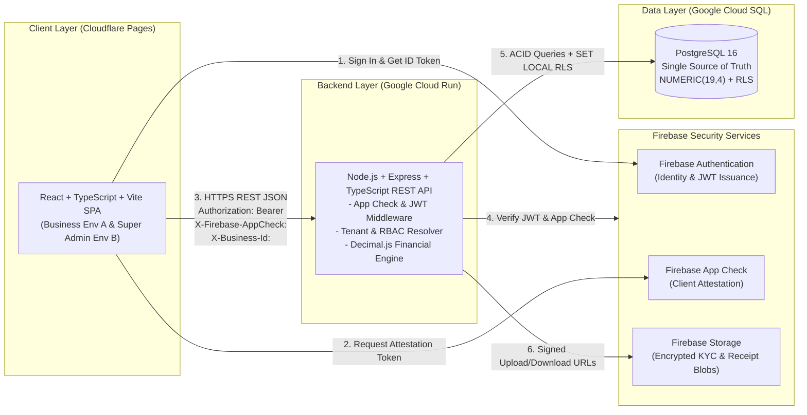

# FloTech Digital — System Architecture Specification

## 1. High-Level Frontend / Backend / Cloud Architecture

The FloTech Digital Loan Management SaaS follows a strictly separated, cloud-native three-tier architecture designed for financial accuracy, regulatory auditability, and multi-tenant isolation.



---

## 2. Communication Between Services

1. **Frontend to Backend (`HTTPS REST API`)**:
   - The React SPA communicates exclusively with the Node.js/Express REST API over HTTPS (`/api/v1/*`).
   - All request and response payloads conform to the shared TypeScript contracts in [`packages/shared/src/index.ts`](file:///home/antigravity/packages/shared/src/index.ts) (`ApiSuccessResponse<T>` and `ApiErrorResponse`).
   - Every response includes a correlation header `X-Request-Id` generated or validated by [`attachRequestId`](file:///home/antigravity/backend/src/middleware/errorHandler.ts) for end-to-end distributed tracing and audit logging.
   - All monetary values in JSON payloads are transmitted as `DecimalString` (`"15000.0000"`)—never as IEEE 754 floating-point numbers.

2. **Backend to PostgreSQL (`node-postgres` Pool)**:
   - The backend connects to PostgreSQL via a managed connection pool in [`backend/src/database/pool.ts`](file:///home/antigravity/backend/src/database/pool.ts).
   - PostgreSQL OID `1700` (`NUMERIC`) is explicitly registered to parse as a `string` so `node-postgres` never casts database decimals into lossy JavaScript floats.
   - Multi-step financial mutations (loan disbursement, schedule generation, repayment waterfall allocation, receipt creation) execute inside a single `BEGIN ... COMMIT` PostgreSQL transaction.

3. **Backend & Frontend to Firebase Storage**:
   - Firebase Storage is used strictly for binary object storage (customer KYC documents, signed loan agreements, generated PDF receipts).
   - All document metadata, ownership (`business_id`, `customer_id`), verification status, and storage paths are recorded in PostgreSQL (`customer_documents`, `payment_receipts`).

---

## 3. Authentication & Authorization Flow

```mermaid
sequenceDiagram
  autonumber
  participant User as Browser SPA
  participant FB as Firebase Auth & App Check
  participant API as Cloud Run Express API
  participant DB as PostgreSQL (Cloud SQL)

  User->>FB: Authenticate (Email/Password or MFA)
  FB-->>User: Firebase ID Token (JWT) + App Check Token
  User->>API: Request /api/v1/businesses/:businessId/loans\nHeaders: Authorization, X-Firebase-AppCheck, X-Business-Id
  API->>FB: verifyAppCheckToken(X-Firebase-AppCheck)
  API->>FB: verifyIdToken(Authorization Bearer JWT, checkRevoked=true)
  API->>DB: SELECT id, platform_role, is_active FROM users WHERE firebase_uid = $1
  DB-->>API: Canonical User Row (platform_role = USER | SUPER_ADMIN)
  API->>DB: SELECT membership, role, ARRAY_AGG(permission_code)\nFROM business_memberships JOIN roles JOIN role_permissions\nWHERE business_id = $1 AND user_id = $2 AND status = 'ACTIVE'
  DB-->>API: Active Tenant Membership & Permission Set
  API->>API: Verify required PermissionCode (e.g. loans:view)
  API->>DB: BEGIN; SELECT set_config('app.current_business_id', $1, true); ... COMMIT;
  DB-->>API: Tenant-Isolated Query Result
  API-->>User: 200 OK ApiSuccessResponse<T>
```

---

## 4. Database Access Strategy

- **Single Source of Truth**: PostgreSQL stores 100% of relational, identity profile, tenant membership, RBAC, customer, loan, schedule, repayment, subscription, notification, and audit data.
- **Explicit Parameterized SQL**: Queries use parameterized SQL (`$1, $2, ...`) with strongly-typed row interfaces in [`backend/src/models/entities.ts`](file:///home/antigravity/backend/src/models/entities.ts) to prevent SQL injection and maintain full control over complex financial joins, `SELECT ... FOR UPDATE` row locking, and window functions.
- **Zero Float Arithmetic**: All calculations run through [`backend/src/financial/decimalEngine.ts`](file:///home/antigravity/backend/src/financial/decimalEngine.ts) using `Decimal.js` (`precision: 34`, `ROUND_HALF_UP`) before being persisted to PostgreSQL `NUMERIC(19, 4)` columns.

---

## 5. Multi-Tenant Data Isolation Strategy (Defense-in-Depth)

FloTech Digital enforces **three independent layers** of tenant isolation so that a bug in any single layer cannot leak data across businesses:

1. **Layer 1 — Middleware Membership Validation ([`requireTenantMembershipMiddleware`](file:///home/antigravity/backend/src/middleware/security.ts))**:
   - The backend never trusts a `businessId` or permission list sent by the frontend.
   - On every request, the backend joins `business_memberships`, `businesses`, `roles`, and `role_permissions` in PostgreSQL to verify that the authenticated user is an `ACTIVE` member of that specific `ACTIVE` business.

2. **Layer 2 — Composite Foreign Keys (`(business_id, id)`)**:
   - Every tenant-owned table (`roles`, `business_memberships`, `customers`, `customer_documents`, `loan_products`, `loans`, `repayment_schedules`, `repayments`, `repayment_allocations`, `payment_receipts`) declares `UNIQUE (business_id, id)`.
   - Child tables reference parent rows using composite foreign keys: `FOREIGN KEY (business_id, loan_id) REFERENCES loans(business_id, id)`.
   - This makes it **mathematically impossible at the PostgreSQL constraint level** for a repayment or schedule in Business A to reference a loan or customer belonging to Business B.

3. **Layer 3 — PostgreSQL Row-Level Security (RLS) ([`withTenantTransaction`](file:///home/antigravity/backend/src/database/pool.ts))**:
   - Every tenant table has `ALTER TABLE ... ENABLE ROW LEVEL SECURITY`.
   - Every tenant transaction sets `SELECT set_config('app.current_business_id', $1, true)` (`SET LOCAL` scoped strictly to the current transaction).
   - PostgreSQL RLS policies enforce `business_id = current_setting('app.current_business_id', true)::uuid`, guaranteeing isolation at the database engine layer.
