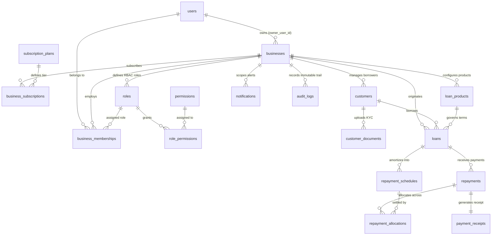

# FloTech Digital — PostgreSQL Database Design Blueprint

The canonical SQL blueprint is located at [`backend/src/database/migrations/001_initial_schema_blueprint.sql`](file:///home/antigravity/backend/src/database/migrations/001_initial_schema_blueprint.sql).

> [!IMPORTANT]
> Per Phase 1 instructions, no production Cloud SQL instance or live migration execution has been triggered yet. This blueprint awaits your review and approval before Phase 2.

---

## 1. Entity-Relationship Diagram (ERD)

---

## 2. Financial Data Types & Precision Rules

1. **Monetary Columns (`NUMERIC(19, 4)`)**:
   - Used for all principals, interest amounts, fees, penalties, balances, repayment allocations, and subscription prices.
   - Supports values up to $\pm 999,999,999,999,999.9999$ with 4 exact decimal places to eliminate intermediate rounding drift before final currency display.
2. **Interest Rate & Percentage Columns (`NUMERIC(10, 6)`)**:
   - Used for `nominal_interest_rate_percent`, `origination_fee_percent`, and `late_penalty_rate_percent`.
   - Allows exact representation of fractional periodic rates up to 6 decimal places.
3. **Database-Level Accounting Invariants (`CHECK` Constraints)**:
   - On `repayments`, the constraint `chk_repayment_allocation_sum` guarantees that:
     $$\text{allocated\_penalty} + \text{allocated\_fee} + \text{allocated\_interest} + \text{allocated\_principal} + \text{overpayment\_credit} = \text{amount\_received}$$
   - Non-negative `CHECK (>= 0)` constraints protect every balance and due column from negative corruption.

---

## 3. Core Table Specifications & Relationships

### A. Platform & Identity Domain
- **`users`**: Maps Firebase Authentication `firebase_uid` (unique) to FloTech's internal UUID. Stores `platform_role` (`USER` or `SUPER_ADMIN`), Protected by PostgreSQL trigger `trg_enforce_super_admin_protection`.
- **`platform_settings`**: Key-value JSONB configuration managed exclusively by FloTech Digital Super Admins.

### B. Multi-Tenant Business & Subscription Domain
- **`subscription_plans`**: Defines commercial tiers (`monthly_price`, `annual_price`, `max_active_loans`, `max_employees`, `max_customers`).
- **`businesses`**: The root tenant entity (`business_code`, `legal_name`, `currency_code`, `status`, `owner_user_id`).
- **`business_subscriptions`**: Links a `business_id` to its active `plan_id`, billing period, and `subscription_status_type`.

### C. Role-Based Access Control (RBAC) & Employee Domain
- **`permissions`**: System-wide catalog of atomic permission codes (e.g., `loans:approve`, `repayments:record`).
- **`roles`**: Tenant-scoped roles (`business_id`, `slug`, `name`, `is_system_role`). Includes composite key `UNIQUE (business_id, id)`.
- **`role_permissions`**: Maps `(business_id, role_id)` to `permission_code`.
- **`business_memberships`**: Represents employees/members linking `user_id` to `business_id` and `role_id`, with employment metadata (`employee_code`, `job_title`, `status`).

### D. Customer & KYC Domain
- **`customers`**: Borrower records scoped to `business_id` with unique `(business_id, customer_number)`, contact details, `monthly_income` (`NUMERIC(19,4)`), and internal risk tier.
- **`customer_documents`**: Metadata and `firebase_storage_path` for borrower KYC files. Enforces composite FK `(business_id, customer_id) -> customers(business_id, id)`.

### E. Loan Products, Origination & Schedule Domain
- **`loan_products`**: Reusable lending templates per business (`interest_method`, `repayment_frequency`, `nominal_interest_rate_percent`, principal/term bounds, origination fees, late penalties, and grace period days).
- **`loans`**: Individual loan contracts storing both **immutable contracted totals** (`principal_amount`, `total_interest_amount`, `total_fee_amount`, `total_payable_amount`) and **live outstanding ledger balances** (`principal_outstanding`, `interest_outstanding`, `fee_outstanding`, `penalty_outstanding`, `total_outstanding`).
- **`repayment_schedules`**: Ordered installments (`installment_number = 1..N`) with opening balance, due components (`principal_due`, `interest_due`, `fee_due`, `penalty_due`), paid components (`principal_paid`, `interest_paid`, `fee_paid`, `penalty_paid`), and closing principal balance.

### F. Repayment Waterfall & Receipts Domain
- **`repayments`**: Immutable payment ledger entries with `amount_received` and component breakdown (`allocated_penalty`, `allocated_fee`, `allocated_interest`, `allocated_principal`, `overpayment_credit`). Supports audited reversals (`is_reversed`, `reversed_by_user_id`, `reversal_reason`) rather than destructive `DELETE` statements.
- **`repayment_allocations`**: Granular junction table recording exactly how much of a single `repayment_id` was applied to each `schedule_id` installment.
- **`payment_receipts`**: Immutable receipt records (`receipt_number`, `snapshot_json`, `pdf_storage_path`) tied 1-to-1 with a `repayment_id`.

### G. Governance, Notifications & Audit Domain
- **`notifications`**: User-targeted alerts optionally scoped to a `business_id`.
- **`audit_logs`**: Append-only audit trail recording `business_id`, `actor_user_id`, `actor_platform_role`, `action`, `entity_type`, `entity_id`, `before_state` (JSONB), and `after_state` (JSONB).
